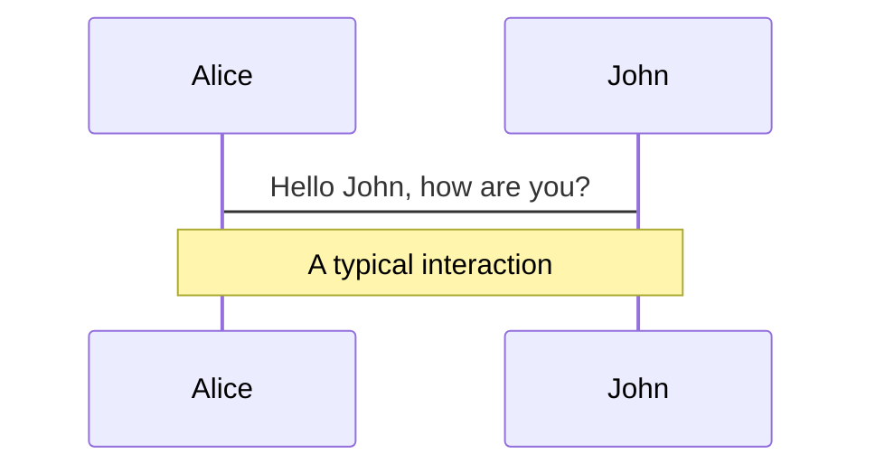
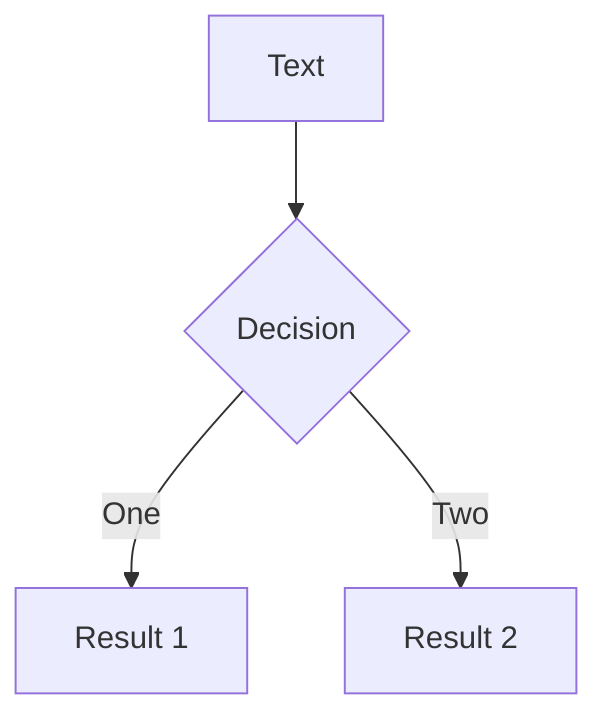
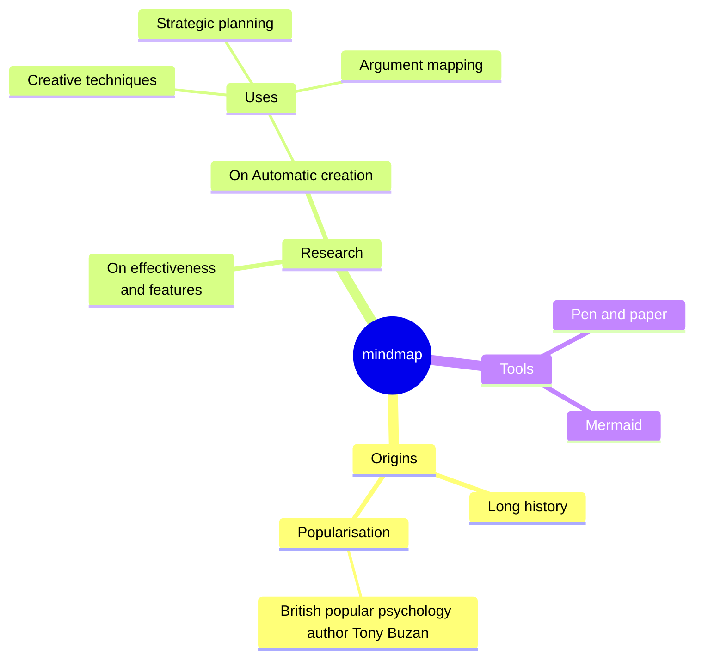
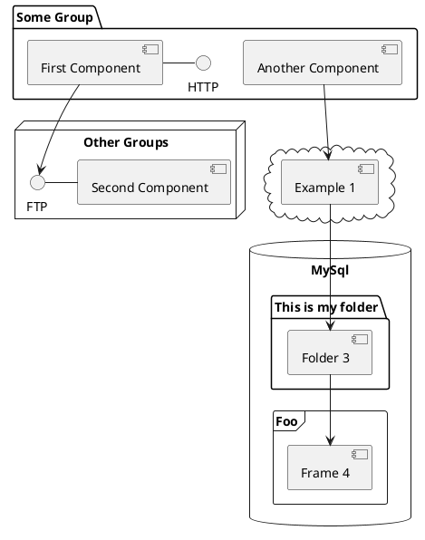

---
# try also 'default' to start simple
theme: seriph
# random image from a curated Unsplash collection by Anthony
# like them? see https://unsplash.com/collections/94734566/slidev
# background: https://cover.sli.dev
background: /public/background.jpg
# some information about your slides (markdown enabled)
title: Presentation d'OSM (OpenStreetMap)
info: |
  ## Presentation d'OSM (OpenStreetMap)
  OpenstreetMap (OSM) est une carte collaborative et libre

  [En savoir plus sur OpenStreetMap](https://www.openstreetmap.org/)
# apply UnoCSS classes to the current slide
class: text-center
# https://sli.dev/features/drawing
drawings:
  persist: false
# slide transition: https://sli.dev/guide/a`nimations.html#slide-transitions
transition: slide-left
# enable Comark Syntax: https://comark.dev/syntax/markdown
comark: true
# duration of the presentation
duration: 30min
---

# OpenStreetMap

## Carte collaborative et libre

Présentation pour la cartopartie du 24 octbre 2026
  <br>
<small>Par Édouard Lopez / Groupe Mapadour</small>

<div @click="$slidev.nav.next" class="mt-12 py-1" hover:bg="white op-10">
  [Space] <carbon:arrow-right />  
</div>

<div class="abs-br m-6 text-xl">
  <button @click="$slidev.nav.openInEditor()" title="Open in Editor" class="slidev-icon-btn">
    <carbon:edit />
  </button>
  <a href="https://github.com/slidevjs/slidev" target="_blank" class="slidev-icon-btn">
    <carbon:logo-github />
  </a>
</div>

<!--
The last comment block of each slide will be treated as slide notes. It will be visible and editable in Presenter Mode along with the slide. [Read more in the docs](https://sli.dev/guide/syntax.html#notes)
-->
---

# Sommaire  

<Toc minDepth="1" maxDepth="1" />


---
layout: two-cols
---

# Contexte

* Orx: village nature et nourricier
* Inclus Kfé: café associatif, inclusion et lieu de rencontre
* Mapadour: groupe local de contributeurs OSM sur le Pays-Basque et le Sud des landes
* Édouard: Ingénieur logiciel et contributeur des communs (OSM, Wiki, Jardin Partagé)


::right::


---

# Historique

La France a une tradition de la cartographie !
* [Carte de Cassini][cassini] au XVIIIe siècle
* Cartes topographiques de l'[IGN][ign] au XXe siècle
* Transition vers les [cartes numériques et collaboratives][osm] au XXIe siècle

  * base libre de données géographiques au Monde.
    * 1 lieu = plusieurs informations
  * Principe de collaboration
  * En évolution permanente

[cassini]: https://fr.wikipedia.org/wiki/Carte_de_Cassini
[ign]: https://fr.wikipedia.org/wiki/Institut_national_de_l%27information_g%C3%A9ographique_et_foresti%C3%A8re
[osm]: https://openstreetmap.org

---
layout: two-cols
---

## Participatif

OpenStreetMap, c’est l’équivalent de Wikipédia pour les cartes

Vous connaissez bien le quartier dans lequel vous vivez? Quelques choses à changer ? C'est l'occasion de contribuer

### 🌪💥 Lors de crises

OpenStreetMap permet de [cartographier rapidement les zones touchées][crisis-mapping] pour faciliter l'aide et la coordination des secours.

ex. Lors du passage à  [Mayotte de la tempête Chido : cartographie des dommages des bâtiments][mayotte-chido]

[crisis-mapping]: https://doi.org/10.1111/1468-5973.12330
[mayotte-chido]: https://forum.openstreetmap.fr/t/mayotte-chido-cartographie-des-dommages-des-batiments/31722

::right::

<div class="flex flex-col items-center gap-2 align-center">

  <figure class="flex flex-col items-center">
  
  <figcaption class="text-center">

  [StreetComplete](https://streetcomplete.app/)

  </figcaption>
  </figure>

  <figure class="flex flex-col items-center">
  
  <figcaption class="text-center">

  l'[Éditeur web d'OSM](https://www.openstreetmap.org)

  </figcaption>
  </figure>

  <figure class="flex flex-col items-center">
  
  <figcaption class="text-center">

  [Panoramax](https://panoramax.openstreetmap.fr)

  </figcaption>
  </figure>
</div>

---
layout: image
---

---

## Mondial

* OpenStreetMap est la plus grande base libre de données géographiques au Monde.
* +10 millions de contributeur-ices dans le monde entier (chiffres de 2025) ;

> Nous cartographions le globe, rue après rue, chemin après chemin, tout simplement.


---

## Libre

Vous êtes libre d’utiliser, télécharger et remixer toutes nos données, et ce même dans un but commercial. Les données sont publiées sous license ouverte

> Nous croyons en un monde où les données cartographiques sont libres et ouvertes.


[À quoi ça sert ? Il y a déjà l’IGN et Google/Bing/etc. Maps…][ya-google-map]
* les données ne sont pas libres
* le rendu des cartes est souvent
  * figé et non personnalisable
  * publicitaire
* màj focalisé sur les zones économiquement intéressantes

[ya-google-map]: https://www.palabritudes.net/2024/08/15/quinze-ans-contribution-osm.html


---
layout: two-cols
---

# Des données de qualité

Des données basées sur les connaissances du terrain, collectées par des contributeur-ices du monde entier.

La qualité des données motive les institutions à collaborer avec OSM: 
* Base Adresses Nationale
* projet [Panoramax][panoramax]

[panoramax]: https://panoramax.openstreetmap.fr

::right::

# Mise à jour en continue

Constamment mises à jour par des contributeur-ices du monde entier et mise à disposition à la volée.

* [Pifomètre][pifometre]: rapprocher les données OpenStreetMap, le fichier Topo (ex-Fantoir), le cadastre et la BAN pour favoriser l'enrichissement

[pifometre]: https://www.palabritudes.net/2024/08/15/quinze-ans-contribution-osm.html
---

## Des cartes

La carte est un objet du quotidien. Nous l’utilisons pour représenter le territoire, nous repérer dans l’espace et nous guider. OpenStreetMap permet de créer de nombreuses cartes personnalisées.
[En savoir plus](https://www.openstreetmap.fr/carte/)

---

## Utilisez par… !

De nombreux acteurs s’appuient sur l’écosystème OpenStreetMap, ses données, ses cartes ou encore ses services. Nous y retrouvons des citoyennes et des citoyens, des collectivités, des associations et des entreprises de toutes tailles:

* Entreprises: Amazon, Apple, Baidu Maps, Facebook, Microsoft, Wikipedia, Pinterest etc.
* Gouvernements: 🇫🇷 Gendarmerie et Police, 🇧🇷 Brésil, France Base des adresses nationales, 🇮🇹 Italie, 🇱🇸 Lesotho, 🇱🇹 Lithuania, 🇵🇱 Pologne, 🇨🇦 Canada, etc.
* Entreprises du TransporT: SNCF, Air France, Uber, Deutsche Bahn, etc.
* Associations: MSF (Médecins Sans Frontières), ONU (Organisation des Nations Unies), Croix Rouge, etc.
* Universités: Cambridge
* Media: BBC, Wall Street Journal, etc.

[Qui l'utilise ?][qui-utilise]

[qui-utilise]: https://welcome.openstreetmap.org/about-osm-community/consumers/


---

# Communauté
  * Fondation (monde) 2006
  * Association OSM-France 2011
  * Mapadour: Sud-Landes Pays-Basque


---
layout: two-cols
---
# StreetComplete

* iOS & Android

  <figure class="flex flex-col items-center">
  
  <figcaption class="text-center">

  [StreetComplete](https://streetcomplete.app/)

  </figcaption>
  </figure>
  
::right::


---
layout: two-cols
---
# L'Éditeur web d'OSM
  
::right::

  <figure class="flex flex-col items-center">
  
  <figcaption class="text-center">

  l'[Éditeur web d'OSM](https://www.openstreetmap.org)

  </figcaption>
  </figure>

---
layout: two-cols
---

# Panoramax


  <figure class="flex flex-col items-center">
  
  <figcaption class="text-center">

  [Panoramax](https://panoramax.openstreetmap.fr)

  </figcaption>
  </figure>

::right::

<figure>
  
  <figcaption class="text-center">

  Panoramax Preview

  </figcaption>
</figure>
<figure>
  
  <figcaption class="text-center">

  Jardin <s>partagé</s> d'Orx

  </figcaption>
</figure>

---

# Fonctionnalités
  * Exploration
  * Calcul d'itinéraire
  * Affichage spécifique
  * Édition collaborative

---

# Cartopartie

---

# OSM C'est quoi ?

Slidev is a slides maker and presenter designed for developers, consist of the following features

* 📝 **Text-based** - focus on the content with Markdown, and then style them later
* 🎨 **Themable** - themes can be shared and re-used as npm packages
* 🧑‍💻 **Developer Friendly** - code highlighting, live coding with autocompletion
* 🤹 **Interactive** - embed Vue components to enhance your expressions
* 🎥 **Recording** - built-in recording and camera view
* 📤 **Portable** - export to PDF, PPTX, PNGs, or even a hostable SPA
* 🛠 **Hackable** - virtually anything that's possible on a webpage is possible in Slidev
<br>


<br>

Read more about [Why Slidev?](https://sli.dev/guide/why)

<!--
You can have `style` tag in markdown to override the style for the current page.
Learn more: https://sli.dev/features/slide-scope-style
-->

<style>
h1 {
  background-color: #2B90B6;
  background-image: linear-gradient(45deg, #4EC5D4 10%, #146b8c 20%);
  background-size: 100%;
  -webkit-background-clip: text;
  -moz-background-clip: text;
  -webkit-text-fill-color: transparent;
  -moz-text-fill-color: transparent;
}
</style>

<!--
Here is another comment.
-->

---
transition: slide-up
level: 2
---

# Navigation

Hover on the bottom-left corner to see the navigation's controls panel, [learn more](https://sli.dev/guide/ui#navigation-bar)

## Keyboard Shortcuts

|                                                     |                             |
| --------------------------------------------------- | --------------------------- |
| <kbd>right</kbd> / <kbd>space</kbd>                 | next animation or slide     |
| <kbd>left</kbd>  / <kbd>shift</kbd><kbd>space</kbd> | previous animation or slide |
| <kbd>up</kbd>                                       | previous slide              |
| <kbd>down</kbd>                                     | next slide                  |

<!-- https://sli.dev/guide/animations.html#click-animation -->

<p v-after class="absolute bottom-23 left-45 opacity-30 transform -rotate-10">Here!</p>

---
layout: two-cols
layoutClass: gap-16
---

# Table of contents

You can use the `Toc` component to generate a table of contents for your slides:

```html
<Toc minDepth="1" maxDepth="1" />
```

The title will be inferred from your slide content, or you can override it with `title` and `level` in your frontmatter.

::right::

<Toc text-sm minDepth="1" maxDepth="2" />

---

layout: image-right
image: <https://cover.sli.dev>
---

# Code

Use code snippets and get the highlighting directly, and even types hover!

```ts [filename-example.ts] {all|4|6|6-7|9|all} twoslash
// TwoSlash enables TypeScript hover information
// and errors in markdown code blocks
// More at https://shiki.style/packages/twoslash
import { computed, ref } from 'vue'

const count = ref(0)
const doubled = computed(() => count.value * 2)

doubled.value = 2
```

<arrow v-click="[4, 5]" x1="350" y1="310" x2="195" y2="342" color="#953" width="2" arrowSize="1" />

<!-- This allow you to embed external code blocks -->
<<< @/snippets/external.ts#snippet

<!-- Footer -->

[Learn more](https://sli.dev/features/line-highlighting)

<!-- Inline style -->
<style>
.footnotes-sep {
  @apply mt-5 opacity-10;
}
.footnotes {
  @apply text-sm opacity-75;
}
.footnote-backref {
  display: none;
}
</style>

<!--
Notes can also sync with clicks

[click] This will be highlighted after the first click

[click] Highlighted with `count = ref(0)`

[click:3] Last click (skip two clicks)
-->

---

level: 2
---

# Shiki Magic Move

Powered by [shiki-magic-move](https://shiki-magic-move.netlify.app/), Slidev supports animations across multiple code snippets.

Add multiple code blocks and wrap them with <code>````md magic-move</code> (four backticks) to enable the magic move. For example:

````md magic-move {lines: true}
```ts {*|2|*}
// step 1
const author = reactive({
  name: 'John Doe',
  books: [
    'Vue 2 - Advanced Guide',
    'Vue 3 - Basic Guide',
    'Vue 4 - The Mystery'
  ]
})
```

```ts {*|1-2|3-4|3-4,8}
// step 2
export default {
  data() {
    return {
      author: {
        name: 'John Doe',
        books: [
          'Vue 2 - Advanced Guide',
          'Vue 3 - Basic Guide',
          'Vue 4 - The Mystery'
        ]
      }
    }
  }
}
```

```ts
// step 3
export default {
  data: () => ({
    author: {
      name: 'John Doe',
      books: [
        'Vue 2 - Advanced Guide',
        'Vue 3 - Basic Guide',
        'Vue 4 - The Mystery'
      ]
    }
  })
}
```

Non-code blocks are ignored.

```vue
<!-- step 4 -->
<script setup>
const author = {
  name: 'John Doe',
  books: [
    'Vue 2 - Advanced Guide',
    'Vue 3 - Basic Guide',
    'Vue 4 - The Mystery'
  ]
}
</script>
```
````

---

# Components

<div grid="~ cols-2 gap-4">
<div>

You can use Vue components directly inside your slides.

We have provided a few built-in components like `<Tweet/>`, `<BlueSky/>`, and `<Youtube/>` that you can use directly. And adding your custom components is also super easy.

```html
<Counter :count="10" />
```

<!-- ./components/Counter.vue -->
<Counter :count="10" m="t-4" />

Check out [the guides](https://sli.dev/builtin/components.html) for more.

</div>
<div>

```html
<Tweet id="1390115482657726468" />
```

<Tweet id="1390115482657726468" scale="0.65" />

</div>
</div>

<!--
Presenter note with **bold**, *italic*, and ~~striked~~ text.

Also, HTML elements are valid:
<div class="flex w-full">
  <span style="flex-grow: 1;">Left content</span>
  <span>Right content</span>
</div>
-->

---

class: px-20
---

# Themes

Slidev comes with powerful theming support. Themes can provide styles, layouts, components, or even configurations for tools. Switching between themes by just **one edit** in your frontmatter:

<div grid="~ cols-2 gap-2" m="t-2">

```yaml
---
theme: default
---
```

```yaml
---
theme: seriph
---
```


</div>

Read more about [How to use a theme](https://sli.dev/guide/theme-addon#use-theme) and
check out the [Awesome Themes Gallery](https://sli.dev/resources/theme-gallery).

---

# Clicks Animations

You can add `v-click` to elements to add a click animation.

<div v-click>

This shows up when you press <kbd>space</kbd> or <kbd>right</kbd>, or click outside the slide on the right.

```html
<div v-click>This shows up when you trigger a click animation.</div>
```

</div>

<p v-click>
You can also add modifiers to change the animation:
</p>

<div class="grid gap-3 mt-4 text-sm" style="grid-template-columns: repeat(3, 1fr) 1.5fr 1fr">
  <div v-after.up class="p-3 rounded border border-primary/20 bg-primary/10">
    <div class="font-mono text-xs opacity-60 mb-1">v-click.up</div>
    <div>Slide from bottom</div>
  </div>
  <div v-click.fade-in class="p-3 rounded border border-primary/30 bg-primary/15">
    <div class="font-mono text-xs opacity-60 mb-1">v-click.fade-in</div>
    <div>Fade in</div>
  </div>
  <div v-click.fade class="p-3 rounded border border-primary/40 bg-primary/20">
    <div class="font-mono text-xs opacity-60 mb-1">v-click.fade</div>
    <div>Dim (0.5 opacity)</div>
  </div>
  <div v-click.fade.right.scale class="p-3 rounded border border-primary/50 bg-primary/25">
    <div class="font-mono text-xs opacity-60 mb-1">v-click.fade.right.scale</div>
    <div>Composed</div>
  </div>
  <div v-click.none class="p-3 rounded border border-primary/60 bg-primary/30">
    <div class="font-mono text-xs opacity-60 mb-1">v-click.none</div>
    <div>No transition</div>
  </div>
</div>

<v-click>

The <span v-mark.red="7"><code>v-mark</code> directive</span>
also allows you to add
<span v-mark.circle.orange="8">inline marks</span>
, powered by [Rough Notation](https://roughnotation.com/):

```html
<span v-mark.underline.orange>inline markers</span>
```

</v-click>

<div v-click mt-12>

[Learn more](https://sli.dev/guide/animations#click-animation)

</div>

---

# Motions

Motion animations are powered by [@vueuse/motion](https://motion.vueuse.org/), triggered by `v-motion` directive.

```html
<div
  v-motion
  :initial="{ x: -80 }"
  :enter="{ x: 0 }"
  :click-3="{ x: 80 }"
  :leave="{ x: 1000 }"
>
  Slidev
</div>
```

<div class="w-60 relative">
  <div class="relative w-40 h-40">
    
    
    
  </div>

  <div
    class="text-5xl absolute top-14 left-40 text-[#2B90B6] -z-1"
    v-motion
    :initial="{ x: -80, opacity: 0}"
    :enter="{ x: 0, opacity: 1, transition: { delay: 2000, duration: 1000 } }">
    Slidev
  </div>
</div>

<!-- vue script setup scripts can be directly used in markdown, and will only affects current page -->
<script setup lang="ts">
const final = {
  x: 0,
  y: 0,
  rotate: 0,
  scale: 1,
  transition: {
    type: 'spring',
    damping: 10,
    stiffness: 20,
    mass: 2
  }
}
</script>

<div
  v-motion
  :initial="{ x:35, y: 30, opacity: 0}"
  :enter="{ y: 0, opacity: 1, transition: { delay: 3500 } }">

[Learn more](https://sli.dev/guide/animations.html#motion)

</div>

---

# $\LaTeX$

$\LaTeX$ is supported out-of-box. Powered by [$\KaTeX$](https://katex.org/).

<div h-3 />

Inline $\sqrt{3x-1}+(1+x)^2$

Block
$$ {1|3|all}
\begin{aligned}
\nabla \cdot \vec{E} &= \frac{\rho}{\varepsilon_0} \\
\nabla \cdot \vec{B} &= 0 \\
\nabla \times \vec{E} &= -\frac{\partial\vec{B}}{\partial t} \\
\nabla \times \vec{B} &= \mu_0\vec{J} + \mu_0\varepsilon_0\frac{\partial\vec{E}}{\partial t}
\end{aligned}
$$

[Learn more](https://sli.dev/features/latex)

---

# Diagrams

You can create diagrams / graphs from textual descriptions, directly in your Markdown.

<div class="grid grid-cols-4 gap-5 pt-4 -mb-6">









</div>

Learn more: [Mermaid Diagrams](https://sli.dev/features/mermaid) and [PlantUML Diagrams](https://sli.dev/features/plantuml)

---

foo: bar
dragPos:
  square: 691,32,167,_,-16
---

dragPos:
  square: -41,0,0,0
---

dragPos:
  square: -41,0,0,0
---

dragPos:
  square: 0,-332,0,0
---

dragPos:
  square: -41,0,0,0
---

dragPos:
  square: 0,-332,0,0
---

dragPos:
  square: 0,-332,0,0
---

dragPos:
  square: -59,0,0,0
---

dragPos:
  square: 0,-332,0,0
---

dragPos:
  square: 0,-332,0,0
---

dragPos:
  square: -59,0,0,0
---
dragPos:
  square: -59,0,0,0
---

# Draggable Elements

Double-click on the draggable elements to edit their positions.

<br>

###### Directive Usage

```md

```

<br>

###### Component Usage

```md
<v-drag text-3xl>
  <div class="i-carbon:arrow-up" />
  Use the `v-drag` component to have a draggable container!
</v-drag>
```

<v-drag pos="664,206,261,_,-15">
  <div text-center text-3xl border border-main rounded>
    Double-click me!
  </div>
</v-drag>


###### Draggable Arrow

```md
<v-drag-arrow two-way />
```

<v-drag-arrow pos="67,452,253,46" two-way op70 />

---

l
src: ./pages/imported-slides.md
hide: false
---


---

# Monaco Editor

Slidev provides built-in Monaco Editor support.

Add `{monaco}` to the code block to turn it into an editor:

```ts {monaco}
import { ref } from 'vue'
import { emptyArray } from './external'

const arr = ref(emptyArray(10))
```

Use `{monaco-run}` to create an editor that can execute the code directly in the slide:

```ts {monaco-run}
import { version } from 'vue'
import { emptyArray, sayHello } from './external'

sayHello()
console.log(`vue ${version}`)
console.log(emptyArray<number>(10).reduce(fib => [...fib, fib.at(-1)! + fib.at(-2)!], [1, 1]))
```

---

layout: center
class: text-center
---

# Learn More

[Documentation](https://sli.dev) · [GitHub](https://github.com/slidevjs/slidev) · [Showcases](https://sli.dev/resources/showcases)

<PoweredBySlidev mt-10 />
